

## Overview

Since 2024, A Fatt has kept the menus I designed for them up to date on their own, in Canva, without calling me: an English one and a German one, each with Chinese alongside. Guests scan a QR code at the table and open them as PDFs on their phone. In 2026 they came back with a new request: a third menu, of only their vegan and vegetarian dishes.

Designing it was the easy part. Every vegan and vegetarian dish now lived in three PDFs, so every price change was three edits, and one missed edit would put the menus out of step, in front of the guests who read a menu most carefully. Guests had three QR codes to choose from. And the PDFs had a problem of their own: a PDF has one fixed page size, and it doesn't fit every phone's screen.

I had already shown them [menuGen](https://yingshiuan.github.io/yingsc/projects/menu-generator/), my own tool that prints every version from one spreadsheet, and they kept their Canva menus. It fixed the work behind the menu, and a restaurant judges a menu by what its guests see. So I asked a different question: instead of handing each guest the English, the German or the vegan and vegetarian menu, why not put all of it on the website they already had, as a page instead of a file? Collect every dish once, in one Excel sheet, with a column per language and a mark per diet. One sheet means one edit, with nothing left to fall out of step. The page fits whatever screen opens it. And the vegan and vegetarian menu becomes a filter: instead of the restaurant keeping a menu for each kind of guest, each guest filters the one menu on their own phone.

MenuDash is the WordPress plugin I designed and built to do that. It runs the [menu page on afatt.ch](https://afatt.ch/menu/): 110 dishes in three languages, filtered by diet, rebuilt whenever the owner uploads the sheet. Then, because the problem wasn't specific to one restaurant, I made it a product. The core and its theme are open source: [MenuDash on GitHub](https://github.com/yingshiuan/menudash) · [MenuDash Theme](https://github.com/yingshiuan/menudash-theme).

**Where it stands:** live on one restaurant's site since September 2026, with the Specials and Statistics add-ons since October. Handed over in October: the owner uploads the menu herself.

#### Key Highlights

- **I turned a layout problem into a data problem.** The third PDF they asked for could disagree with the other two. Online, it became a filter on one sheet that can't disagree with itself.
- **I designed for two users.** The guest wants their language and their diet in one tap. The owner wants to change a price without calling me.
- **I designed the failure path first.** A wrong file gets a red report and is refused, and the live menu stays online.
- **I split the product where the customers split.** A free core for every café, paid add-ons for a full restaurant, and code where each add-on is its own plugin.

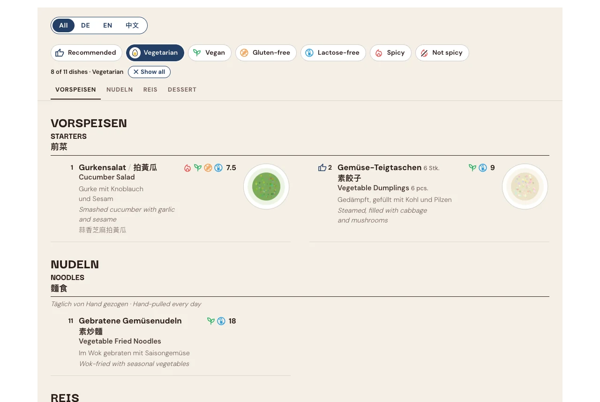

## One Sheet, Two Users

The whole product hangs on one decision: the spreadsheet is the source, and everything the guest sees is a view of it. That made the sheet both the owner's interface and the code's data model, so I designed it for both.

**For the owner, it had to be the sheet they'd write anyway.** A dish is a row; a category is a row with a name and no price. Columns are found by their title, in English or German, so the order doesn't matter and extra columns are ignored. It reads the file the way Swiss Excel writes it, with semicolons, and takes a whole Excel workbook in one upload, each sheet going where it belongs. A missing translation falls back to another language instead of leaving a gap.

**For the guest, the filters had to mean what a guest means.** Vegetarian includes vegan, because a vegetarian can eat it. Spicy and Not spicy switch each other off, because both at once would show nothing. Categories with nothing left are hidden. The guest reads all three languages at once or one at a time, and on a phone a Chinese name that doesn't fit beside the German one moves to its own line.

A filter button only appears when at least one dish has that mark, so a guest never taps Gluten-free and gets an empty menu. The owner decides which buttons the guest sees, and can swap in their own icons. Switching a button off hides only the button; the marks beside the dishes stay, because they're still true.

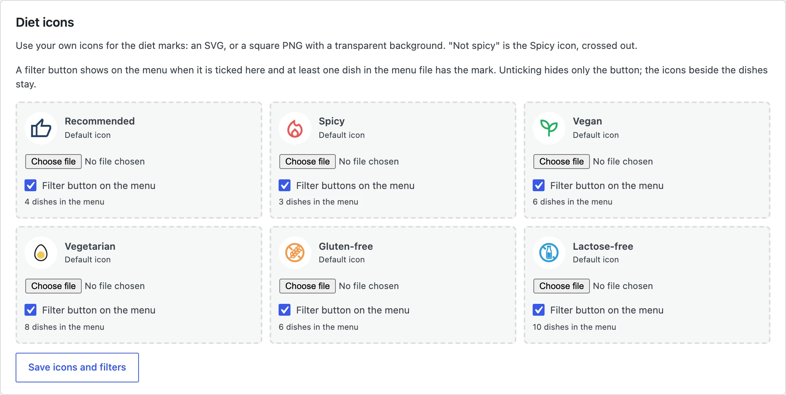

**A selection the guest can pass on.** Choosing from 110 dishes is often a group decision: friends planning a dinner, one person ordering for the table, or someone ordering takeaway. With the selection switched on, each dish gets a + button. The selection shows each dish with its number, its name in the guest's language and the German name under it, because the next person to read it is usually the staff. A dish can carry a question for them. One tap turns it into a picture drawn on the phone, with the dish photos, the restaurant's address and a QR code back to the menu, to save or to send with the menu's link. The picture carries no prices, because it gets passed on and prices change. Nothing is ordered and nothing is sent anywhere; the selection stays in the guest's browser tab.

**And for both of them, it had to be a real web page.** The menu is HTML in all three languages, not a PDF or a picture, so it works without JavaScript and search engines read every dish.

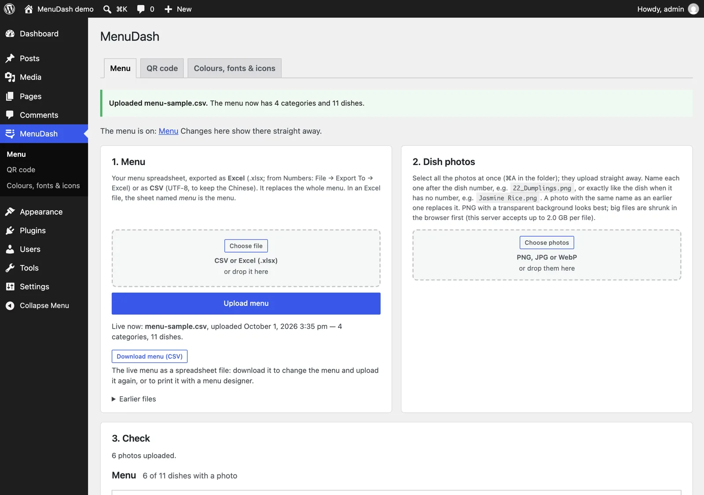

## Designing the Failure Path

Once the menu lives in one sheet, that sheet has to be right, because nobody re-checks a layout anymore. And the person uploading it isn't the person who designed the data. So I designed the upload around getting it wrong:

- **Every upload gets a report.** Green: fine. Yellow: the menu went live, but something looks odd. Red: the file wasn't used, and the old menu stays online.
- **It checks for the mistakes a restaurant actually makes:** a file in the wrong encoding, which would lose the Chinese; the wrong file entirely; two dishes sharing a number; the same dish listed twice with different diet marks.
- **Nothing is final.** The last five uploads are one click away, and the live menu downloads as a file to change and upload again.

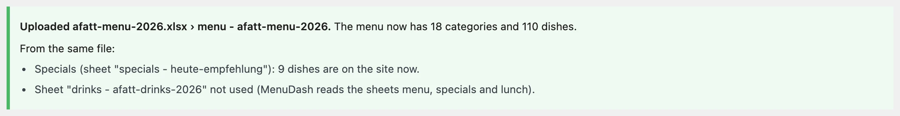

The twin check proved itself on their real menu. Duck Pancakes appeared in two categories, vegetarian in one and unmarked in the other. A guest filtering for vegetarian, the very guest the new menu was for, would have found only one of them. The menu was corrected.

## From a Client Job to a Product

Once the menu worked, the rest of what guests check on a restaurant's site turned out to be the same problem: opening hours, a holiday closure, today's specials, gift cards. Each is something the owner changes in one place and forgets in the others. I built them on the same dashboard page, and by version 1.11 one plugin did all of it.

Then I had to decide how to sell it. My first plan was one package at a lower price. But a small café only needs the menu, and a full restaurant wants all of it, so one price fits neither. At 2.0 I split it along the same line as the customers:

| | What it does | Who needs it |
|---|---|---|
| **MenuDash** (free) | The menu, photos, diet filters, QR table cards, the meat and fish origin list Swiss law requires | Every restaurant and café |
| **Restaurant** | Details entered once, opening hours, an "open now" badge, a holiday notice that takes itself down | A restaurant with a real website |
| **Specials** | Today's specials and the lunch menu of the week | A kitchen that changes its offer |
| **Gift Cards** | Gift card orders by e-mail, nothing paid online | A restaurant that sells gift cards |
| **Shop** | Things guests take home, each with photos, a price, a quantity and a status; guests call or e-mail to buy | A restaurant that sells something besides its meals |
| **Statistics** | Which dishes guests look at, which filters, languages and categories they use, where visits come from, how fast the menu opens, what guests tap next, without cookies | An owner who wants to know what works |

**The fifth add-on came from the client.** At the handover in October 2026, A Fatt asked for a page for things guests can take home. Every add-on before it was one I proposed; this was the first one they asked for, and I built it that day as MenuDash Shop. Each item has photos, a price, a quantity and a status (available, reserved, sold), and its own page with Call and E-mail buttons. There's no cart and no online payment: guests call or write, and pick up at the restaurant. It plugs into the core like the other four, and the Statistics add-on counts its item pages and the taps on those buttons.

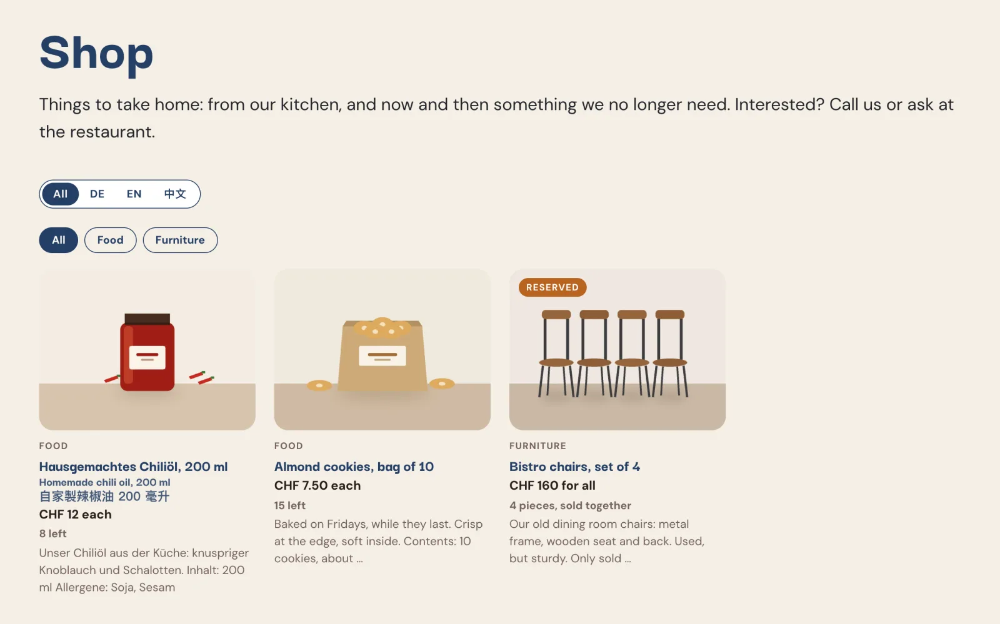

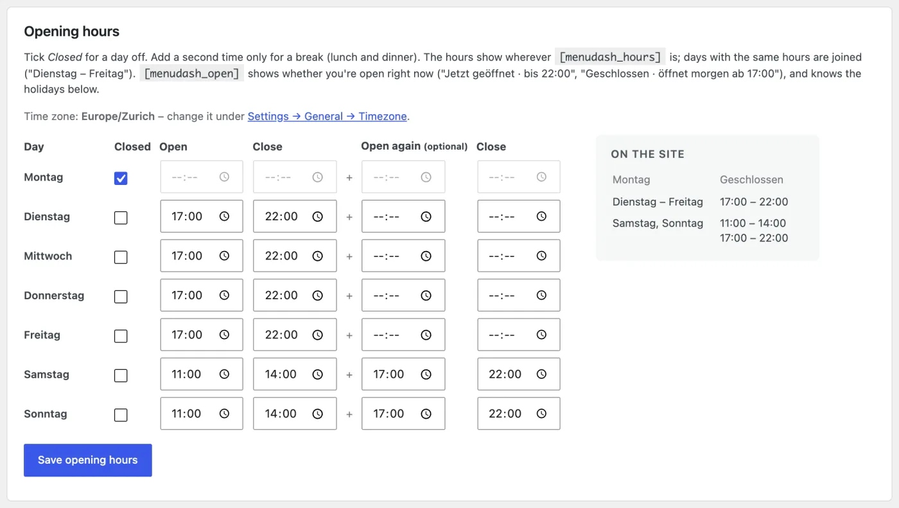

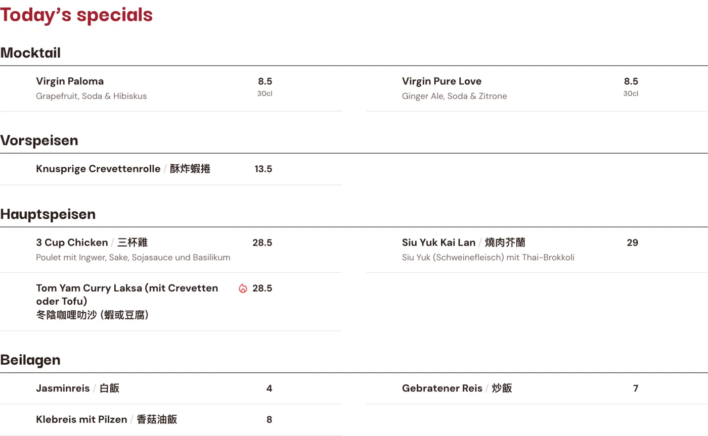

**Why the core is free.** The code is GPL, like WordPress, so anyone who buys a zip may pass it on. Rather than fight that with licence keys, I asked what an owner actually pays for. Most never install a plugin themselves; they pay for someone to set it up, put their menu into the sheet, and answer when something changes. So the business sells the setup and the care: a one-time setup, and a yearly fee for the add-ons' updates and help. The free core is the shop window on GitHub, and it means a restaurant's menu never depends on me.

**Why MenuDash has no online store yet.** Checkout, licence keys and automatic updates only pay off once restaurants I don't know come looking. I planned how they would work and left them unbuilt; until then, every customer is one I set up myself.

## Architecture That Follows the Business

A pricing split only works if the code splits cleanly too. A café on the free core can't see broken pieces of features it didn't buy, and a restaurant that adds Gift Cards next year shouldn't have to reinstall anything.

- **Each add-on is its own plugin** that waits for the core and plugs in through hooks. Without it, its parts show nothing, so a page built for all of them still works with the core alone.
- **The add-ons install without each other.** Gift Cards uses the phone and address from Restaurant when it's installed, and its own fields when it isn't. Shop's Call and E-mail buttons take theirs from Restaurant, so the two are sold together.
- **A browser test runs the core alone and each add-on without the others,** so every package works, including ones nobody has bought yet.
- **The data for search engines splits the same way.** The core marks up the menu; the Restaurant add-on marks up the restaurant and links to that menu by its id. Each package publishes only what it holds, and the two join up when both are installed.
- **One export writes two repositories,** the public core and the private add-ons, and refuses to write the public copy if the client's name, address or photos turn up in it, or if add-on code has leaked into the core.

The theme follows the same rule. It stores no address, phone or hours of its own; it reads them from MenuDash on every page view, and fills in more as add-ons are installed. A restaurant can start with the menu and grow into a full site without a rebuild.

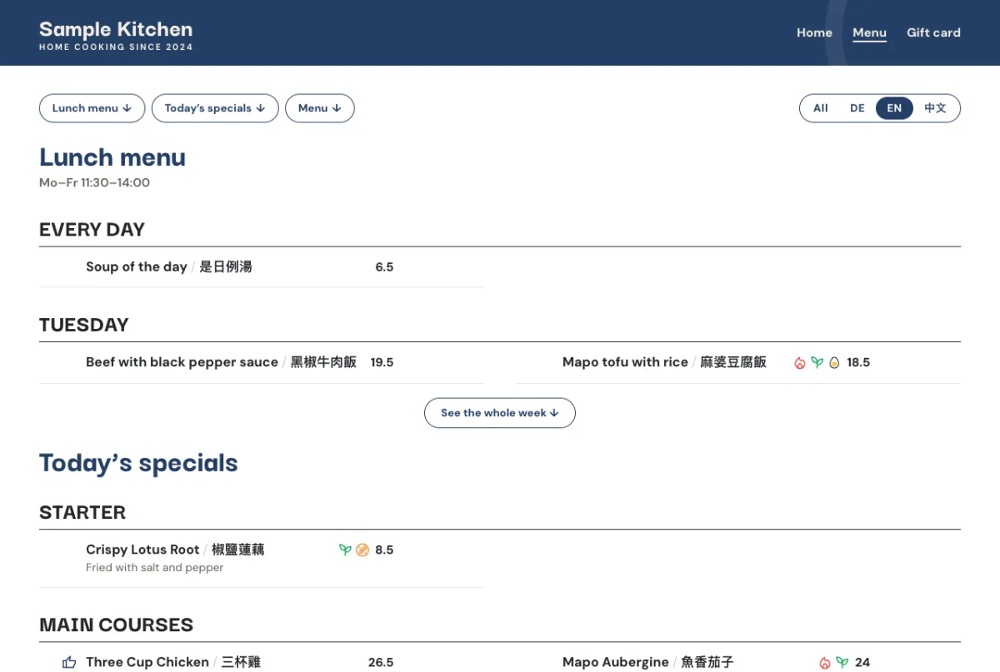

## Counting Without Tracking

The question behind the filters was whether guests would use them. Asking a restaurant to add Google Analytics for that means a cookie banner on a menu page, guest data sent to Google, and a privacy policy the owner doesn't understand. So I asked what actually needs to be known about the menu, and kept only that.

- **What counts is attention, not page views.** A dish counts as seen when it stays on the screen for two seconds, so a guest scrolling past doesn't count. A photo counts when it's opened, a filter when it's turned on, a language when it's chosen, a category button when it's tapped to jump there, each once per visit. Two seconds is my judgment, not a tested number, so a second count at five seconds runs beside it: if the top ten by both are the same dishes, the exact threshold doesn't matter.
- **Only sums are stored.** One row per dish, or per button, and day. No cookies, nothing in the guest's browser, no IP address in the database, and nothing older than 25 months.
- **Fake counts are slowed without identifying anyone.** The endpoint has to take messages from any visitor, so it limits how many each visitor can send. The visitor is a hash of their address with a key that changes every day, kept for ten minutes and deleted within a day at the latest, so nothing stored points to a guest.
- **The owner's own visits don't count,** and neither do guests whose browser asks not to be tracked.

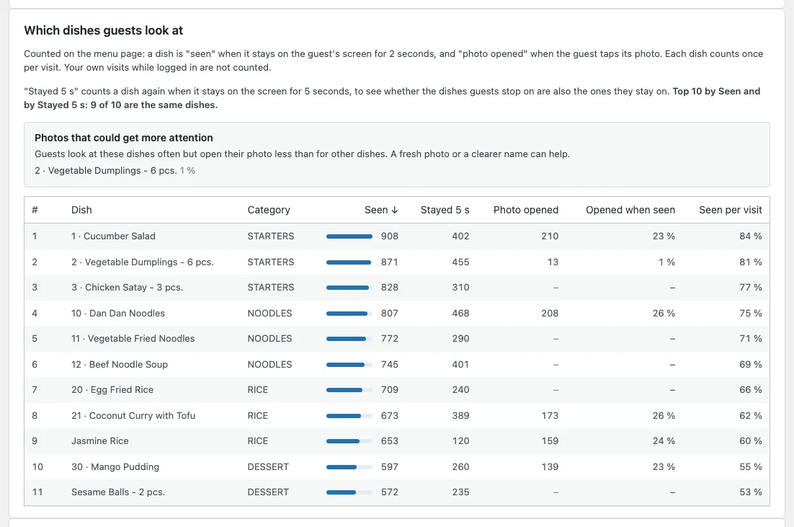

**Then I measured what I needed to know as the one who built it.**

- **Whether guests use the one QR code.** Each menu visit counts under one source (QR code, direct, a search engine, another site), and the QR code the core makes carries a tag for it.
- **Whether the menu opens fast on their phones,** with 72 of the dishes in photos. On menuGen, photos were what ran the server out of memory, so I wanted this one measured. The guest's browser sends only fast, medium or slow, by the limits Google rates pages with, never the time itself.
- **How guests find their way through 18 categories.** A tap on a category button above the menu counts; scrolling there doesn't, so the number shows how many guests use the buttons, not where everyone ends up.
- **Whether a shared selection reaches anyone.** A picture counts when the guest saves or sends it, and the QR code and link on it carry their own tag, so a menu visit that arrives from a shared picture counts under its own source.
- **What guests do next.** Taps on the phone number, the map, the order and booking links, gift card orders that reach the restaurant, and, with the Shop add-on, which item pages are opened and their Call and E-mail taps.
- **Whether a change helped.** The owner marks the day of a new menu or new photos, and the tab compares the same number of days before and after, up to four weeks each, and says there are too few to compare rather than show a large per cent from a handful of visits.

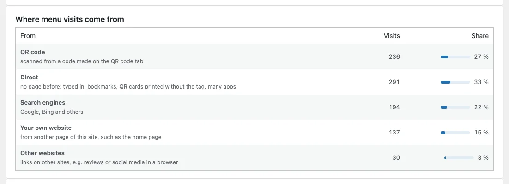

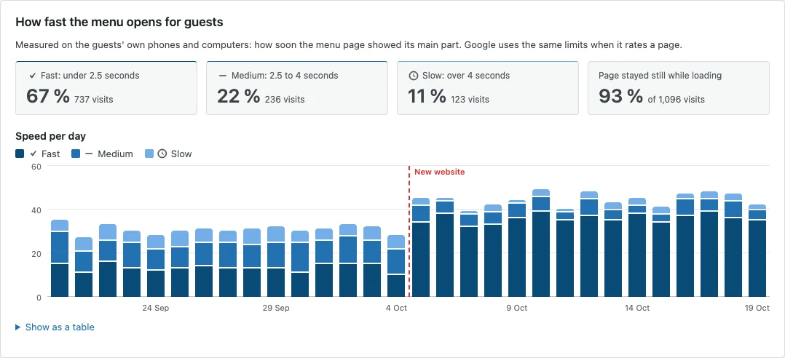

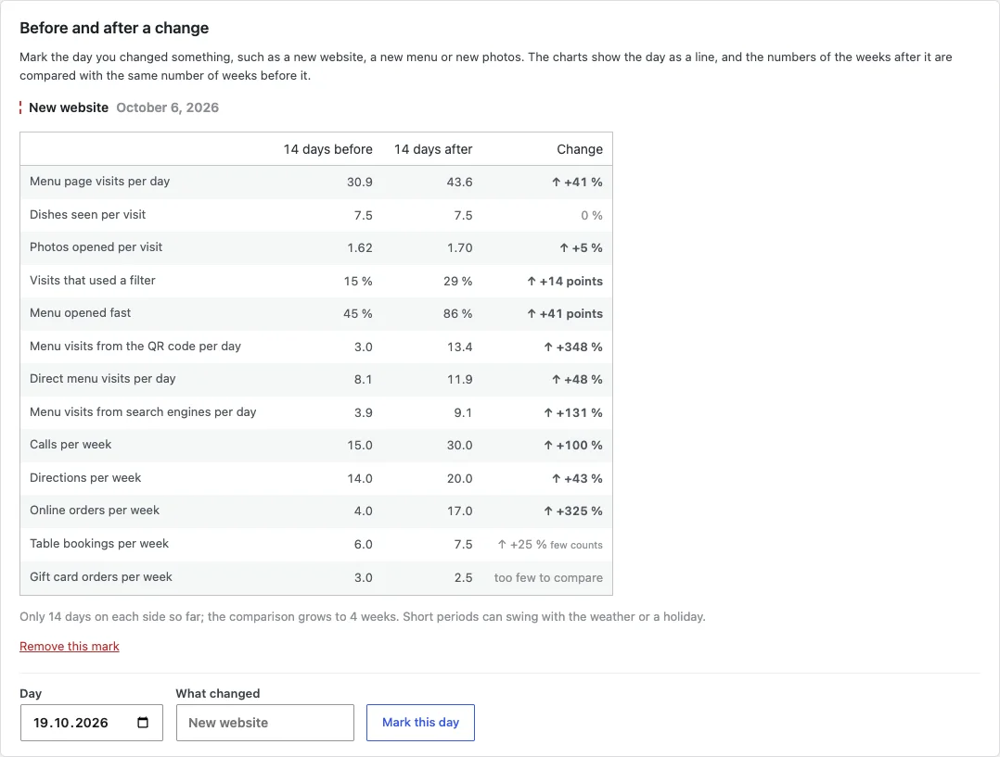

The data is smaller than an analytics tool's, and that's the point: every number answers a question about the menu, and none of it is about a guest. Only the kind of source is counted, never the address a guest came from, and no cookie is set. The privacy paragraph ships with the add-on.

**None of it is sales, so none of it is coloured like an alarm.** A dish that's looked at isn't a dish that's ordered; only the restaurant's own sales can say that. So the tab reads as an observation, not a verdict. Speed comes in shades of one blue, darkest for fast and always with a label, instead of green, yellow and red, because a few slow visits are normal. A suggestion, such as photos that could get more attention, sits in a plain grey box rather than a warning. A change in the before-and-after table shows its direction with an arrow, not in green or red, and one backed by only 10 to 29 counts stays grey and is marked as few counts.

**The same numbers are how I decide what to change in MenuDash.** Whether guests turn the filters on decides whether the filter row stays where it is; how fast the menu opens on their phones decides what I work on next. Nothing is sent to me: the counts stay on the restaurant's own site, and I read the same tab the owner does, with her permission. Measuring it for me took nothing more from the guests than measuring it for the owner.

## How I Built It

I built MenuDash with Claude Code. I designed the product and the data model, wrote the specifications, reviewed every change and decided what shipped. The parser is tested against A Fatt's real spreadsheet as well as made-up ones, and the whole thing runs locally in WordPress Playground, so a site with the client's menu starts with one command.

**I didn't wait for it to be finished.** Three days in, at version 1.1.3, I installed it on afatt.ch to test it against the real site and the real menu, and kept updating it there as each new version shipped. Twelve days later it reached a stable version, 2.7. Testing on the client's site while building is how the real menu's problems showed up early instead of after launch.

**The last step before a release is a security review.** A plugin that takes files from a restaurant owner and a form from any visitor is an open door if nobody checks it, and code that works isn't the same as code that's safe. So before a version ships, I run a review of how it could be abused, and what turns up is fixed before it goes out. Those reviews are where most of the hardening came from:

- **A diet icon can't carry a script.** Uploaded SVGs are cleaned down to plain shapes, and a review found one more way in, a file written in a different text encoding, which is now refused too.
- **A huge photo can't crash the server.** Images over 40 megapixels are refused before they're opened.
- **An Excel file is read as if it were hostile.** A workbook is a zip of XML files, so it is a classic way to attack a server. MenuDash reads only the sheet parts, each with a size cap; refuses XML entities and any path outside the workbook; stops at 3,000 rows by 60 columns; never runs a formula, using the saved values instead; refuses macro workbooks; and never stores the workbook itself, only the CSV made from it.
- **Stored menu files can't be guessed from the web,** because a menu file can hold columns the public page never shows.
- **The gift card form holds up against spam** without needing a login: a hidden field, a signed minimum time, a link filter, and limits per visitor and per day.

## Where It Stands

The core has run A Fatt's menu page since late September 2026, now at version 2.12. The Specials and Statistics add-ons run on A Fatt's site too. Restaurant is installed ahead of the theme: for now it gives search engines the restaurant's address, phone and hours, linked to the menu. Gift Cards, Shop and the theme are built, offered through insdash, and not on A Fatt's site yet, and the guest's selection is installed but not yet switched on. In October 2026 I handed it over: the owner uploads the menu spreadsheet herself, and I still maintain MenuDash and the site for them. A Fatt is the first restaurant running it; the split is built for the ones that come next.

## What's Still Open

- **The guest's side has too little data yet.** Statistics went live on afatt.ch in mid-October 2026, too recently to say what guests do with the filters. The before-and-after comparison is built for exactly that question, and it fills up to four weeks on each side. The first reading decides whether the filter row changes; once there are a few weeks of numbers, I'll add here what they showed and what I changed because of them.
- **Who the selection's picture is for is still a guess.** I built it for a group deciding together and for a takeaway order sent ahead, and the one use I've seen is my own. Before any visits come in, I've written down what share of guests I expect to make a selection, to send it, and to arrive from one. Statistics counts all three, and the owner can say how many takeaway orders arrive as a picture.
- **I'd get the second customer before the next add-on.** It grew from one menu page into a core, five add-ons and a theme in a month, for one restaurant. Shop is the one add-on a client asked for; the rest of the split is still a bet on restaurants I haven't met yet.

